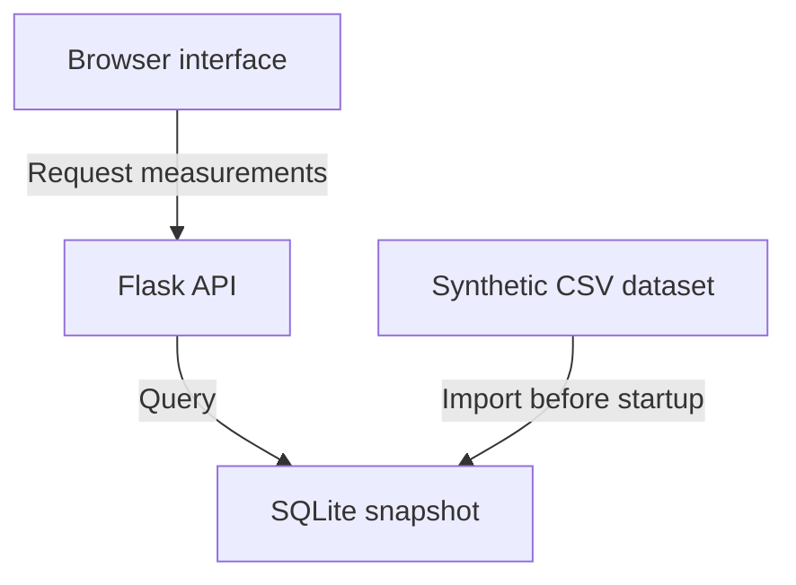

# ASTRA Health — Astronaut Health Monitoring

A web prototype for exploring physiological and environmental measurements during space missions, developed for the NASA Space Apps Challenge.

**[Open the live demo](https://astronaut-health-339040979297.europe-west1.run.app)**

All included measurements are synthetic software-test data. The application is a demonstration, not a medical device or a flight-qualified monitoring system.

## What the prototype does

- Displays heart rate, blood pressure, body temperature, heart-rate variability, oxygen concentration, radiation dose rate, humidity, and cabin temperature.
- Associates measurements with cabin routine, EVA, or cabin-isolation contexts.
- Provides 24-hour and seven-day trend views without drawing every raw sample at once.
- Shows interval means, original ranges, sensors, and scenes on hover; opens original records in a detail view.
- Colors values above configured limits red and values below configured limits blue, with transitions near limits.
- Retains raw outliers with triangle markers and dashed colored segments when averaging conceals a threshold crossing.
- Includes a three-question psychological check-in with a session-only reflection panel.
- Uses an explicit demo snapshot clock so the static dataset remains visible after deployment.

The login screen is a demo entry point, not authentication. The current dashboard selects demo astronaut `1` and mission `10`. Psychological responses and threshold settings are not stored as shared server-side records.

## Technology and data flow

| Layer | Implementation |
| --- | --- |
| Interface | HTML, CSS, JavaScript, SVG charts |
| Backend | Python, Flask |
| Database access | Flask-SQLAlchemy / SQLAlchemy |
| Demo database | SQLite, rebuilt from the included CSV files |
| Production server | Gunicorn |
| Deployment | Docker on Google Cloud Run |



Flask serves the interface and the API from the same application. The browser reads `/api/dashboard-data`; it does not query CSV files directly.

## Included synthetic dataset

The `csv_data_hourly` directory contains 14 CSV files: five reference/relationship tables and nine partitions of the measurement table.

| Property | Value |
| --- | --- |
| Astronauts | 2 fictional crew members |
| Mission duration represented | 7 days |
| Measurement records | 22,848 |
| Blood-pressure frequency | One paired reading per hour per astronaut |
| Other sensor frequency | Every 5 minutes |
| Blood-pressure pairs | 168 per astronaut; 336 total |
| Measurement source label | `csv_simulation` |

The measurement files are `heart_rate.csv`, `systolic_bp.csv`, `diastolic_bp.csv`, `body_temperature.csv`, `rmssd.csv`, `oxygen_concentration.csv`, `radiation_dose_rate.csv`, `humidity.csv`, and `ambient_temperature.csv`.

All nine files import into **one** `measurement_table`. Personal measurements have a `user_id`; public cabin oxygen, humidity, and temperature readings have a blank `user_id`. Blank CSV cells import as SQL `NULL`.

The dataset deliberately includes upper- and lower-limit test windows. These are artificial interface tests, not physiological predictions or measured mission events. Radiation has an upper alarm only. Cabin temperature has no configured alarm limits.

- [`manifest.json`](csv_data_hourly/manifest.json) records file counts and checksums.
- [`anomaly_test_cases.json`](csv_data_hourly/anomaly_test_cases.json) describes the generated test windows and threshold reference.

The importer checks file hashes and rejects an existing destination database. Modified third-party CSV exports will need their own field mapping and validation.

## Database tables

| Table | Purpose |
| --- | --- |
| `user_table` | Fictional crew profiles and demo-account password hashes |
| `mission_table` | Mission information |
| `mission_members` | Many-to-many relationship between crew and missions |
| `indicator_table` | Metric codes, units, and value types |
| `environment_table` | Measurement scenes |
| `measurement_table` | Timestamped measurements and their related IDs |

Blood-pressure rows are matched using the observation group, timestamp, user, and mission. A shared cabin reading describes the cabin even when an astronaut is outside on EVA.

## Run locally on macOS or Linux

Use Python 3.12 to match the container. Open a terminal in the repository directory.

### 1. Create an environment and install dependencies

```bash
python3 -m venv .venv
.venv/bin/python -m pip install -r requirements.txt
```

### 2. Import the dataset

```bash
.venv/bin/python csv_data_hourly/import_csv.py
```

This creates `instance/health_csv_hourly_v4.db`. Skip this step if that database already exists. The importer does not overwrite existing databases.

The existing `app.py` configuration should read:

```python
app.config["SQLALCHEMY_DATABASE_URI"] = os.environ.get(
    "DATABASE_URL",
    "sqlite:///health_csv_hourly_v4.db",
)
```

This configuration belongs before `db = SQLAlchemy(app)`. `os` must be imported at the top of the file.

### 3. Start the production-style server

```bash
DEMO_MODE=true .venv/bin/python -m gunicorn --config gunicorn.conf.py wsgi:app
```

Open **http://127.0.0.1:8080/**. Stop the server with `Control+C`.

If port 8080 is occupied:

```bash
PORT=8081 DEMO_MODE=true .venv/bin/python -m gunicorn --config gunicorn.conf.py wsgi:app
```

Then open **http://127.0.0.1:8081/**.

## Demo time and chart behavior

By default, `DEMO_MODE=true`. The API anchors its time window to the latest valid measurement visible for the selected mission and crew/cabin scope. The interface labels this **Demo snapshot** rather than displaying it as live monitoring.

- **24H:** hourly means for frequent sensors and original hourly paired blood-pressure readings.
- **7D:** four-hour means, up to 42 points per chart, including blood pressure.
- **Card headline:** latest original reading in the selected period.
- **Triangles:** original high/low outliers, which may be away from the mean line.
- **Dashed colored segments:** a raw crossing concealed by the mean.
- **Detail view:** original samples for the selected point or interval.

API fields distinguish `window_end` / `data_as_of` from the actual `server_time`. Setting `DEMO_MODE=false` selects the real server clock; it does not generate new sensor data, so historical records will eventually fall outside the visible period.

## API endpoints

| Endpoint | Purpose |
| --- | --- |
| `/` | Interface |
| `/api/dashboard-data` | Nine metric arrays and snapshot-clock metadata |
| `/healthz` | Basic startup status when running through `wsgi.py` |

Example: `/api/dashboard-data?user_id=1&mission_id=10`.

The demonstration is publicly accessible and does not implement per-user authorization.

## Docker and Cloud Run

The Docker build installs dependencies and imports the bundled CSV dataset into an image-local SQLite snapshot. The container opens that database read-only and runs Gunicorn as a non-root user. It listens on `0.0.0.0` and the `PORT` supplied by Cloud Run.

With Docker installed, a local container can be tested using:

```bash
docker build -t astronaut-health .
docker run --rm -p 8080:8080 astronaut-health
```

For Cloud Run, select your own Google Cloud project and deploy from the directory containing `Dockerfile`:

```bash
gcloud config set project YOUR_PROJECT_ID
gcloud run deploy astronaut-health --source . --region europe-west1 --allow-unauthenticated --min-instances 0 --max-instances 1 --memory 512Mi --cpu 1 --timeout 60
```

Replace `YOUR_PROJECT_ID` with your project ID. Deployment requires the relevant Google Cloud billing/API/IAM setup and can consume credits or incur charges. A maximum instance count is not a spending cap.

Runtime writes to this Cloud Run snapshot are not supported. Persistent user accounts, new measurements, and questionnaire storage require a persistent database and authentication implementation.

Uploading commits to GitHub does not automatically redeploy the existing Cloud Run service; run a deployment again or configure a separate CI/CD workflow.

## Current limitations and next steps

- Demo entry screen; authentication and access control are not implemented.
- Synthetic imported data; no live platform or hardware integration.
- Questionnaire responses are not persisted to the database.
- Thresholds are configurable project inputs, not validated medical standards.
- No persistent server-side writes, automated ingestion, or real-time sensor stream.

Possible next steps include authenticated crew accounts, a persistent database, validated platform imports, questionnaire storage, and task/activity-aware interpretation.

## Credits

Developed for the [NASA Space Apps Challenge](https://www.spaceappschallenge.org/). The included measurements were generated specifically for this software demonstration and should not be attributed to NASA.

Add your actual team name, contributors, and demonstration video link before submission.
